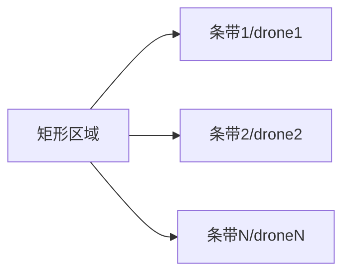

# 多无人机协同分区覆盖搜索

矩形区域均分, 每架机独立走牛耕式往复航线, 互不重叠。

## 原理



## 运行

```bash
cd src/air/uav_multi_area_coverage
python3 main.py
```

发布 `/drone{i}/setpoint_position` 与 `/coverage_report`。详见模块 `README.md`。
