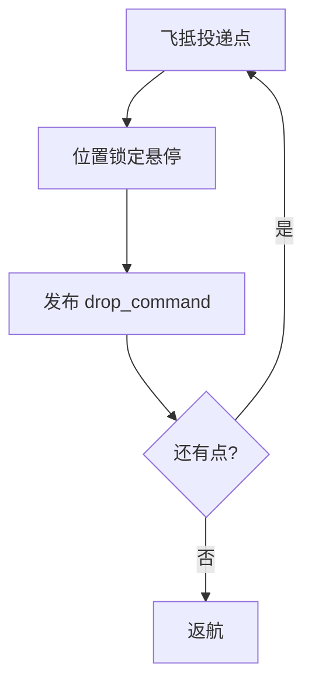

# 无人机空投物资投递

按投递点列表依次飞抵、悬停锁定、触发放物, 最后返航。

## 流程



## 运行

```bash
cd src/air/uav_parcel_delivery
python3 main.py
```

发布 `/drone/setpoint_position`、`/drone/drop_command`、`/delivery_status`。详见模块 `README.md`。
