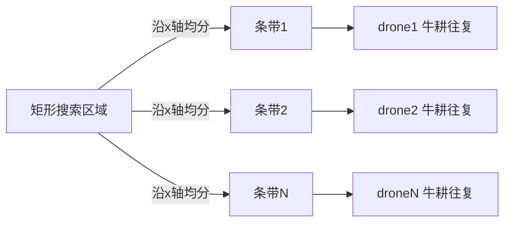

# 多无人机协同分区覆盖搜索

给定矩形搜索区域, 自动均分成 N 个竖直条带, 每架无人机在自己条带内走牛耕式往复航线, 互不重叠, 适合搜救/巡查场景。

与 `uav_formation_flight`(几何编队跟长机)和 `ap_cpp_overfomo`(单机主动感知)的区别:
本模块是**多机静态分区覆盖**, 不保持几何队形, 不在线重规划。

## 运行环境

- Ubuntu 20.04 + ROS 2 Humble
- AirSim 多机模式(或仿真桥接提供 `/drone1/...`, `/drone2/...`)

## 原理



牛耕式: 在条带内按 `strip_spacing` 间距来回走, 相邻航线方向相反。

## 参数

| 参数 | 默认 | 说明 |
|---|---|---|
| `area_x_min/y_min` | -10 | 区域边界 |
| `area_x_max/y_max` | 10 | 区域边界 |
| `flight_height` | 5.0 | 飞行高度(m) |
| `strip_spacing` | 2.0 | 往复航线间距(m) |
| `num_drones` | 2 | 无人机数量 |

## 话题

- 发布: `/drone{i}/setpoint_position` (每架机独立航点)
- 发布: `/coverage_report` (进度或 ALL_DONE)

## 运行

```bash
cd src/air/uav_multi_area_coverage
python3 main.py
```

## 验证范围

- 节点按 `num_drones` 均分区域并生成互不重叠的航点序列
- 进度报告正常发布
- 多机闭环飞行需配合 AirSim 多机桥接
