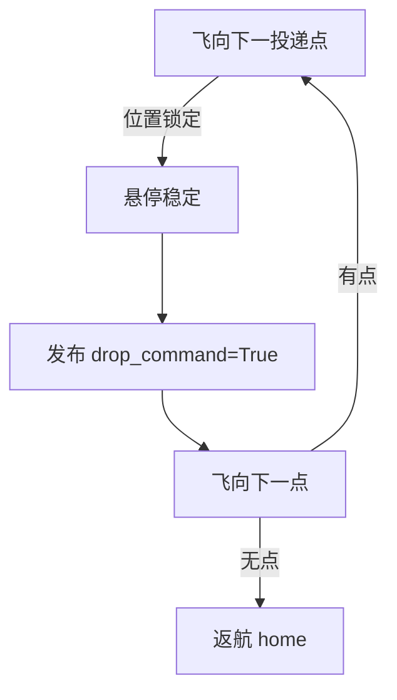

# 无人机空投物资投递

依次飞抵投递点列表上空, 位置锁定后触发放物机构, 再飞向下一点, 全部完成后返航。

## 运行环境

- Ubuntu 20.04 + ROS 2 Humble
- AirSim(或提供投递机构控制话题的桥接)

## 状态流程



## 参数

| 参数 | 默认 | 说明 |
|---|---|---|
| `drop_points` | "5,5,3;-5,-5,3;0,8,3" | 分号分隔的投递点 "x,y,z" |
| `position_tol` | 0.5 | 位置锁定容差(m) |
| `hover_before_drop_s` | 1.0 | 悬停稳定时间(s) |
| `home_x/y/z` | 0/0/0 | 返航点 |

## 话题

| 方向 | 话题 | 类型 |
|---|---|---|
| 订阅 | `/drone/position` | `geometry_msgs/PointStamped` |
| 发布 | `/drone/setpoint_position` | `geometry_msgs/PointStamped` |
| 发布 | `/drone/drop_command` | `std_msgs/Bool` |
| 发布 | `/delivery_status` | `std_msgs/String` |

## 运行

```bash
cd src/air/uav_parcel_delivery
python3 main.py
```

## 验证范围

- 节点按列表顺序飞抵各投递点
- 位置误差小于阈值后发布 drop_command
- 完整投递动作需配合 AirSim 投放机构桥接
